<div align="center">

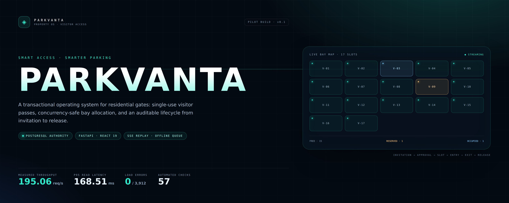

<br />


**Visitor verification · residential parking allocation · smart gate operations**

[Architecture](#architecture) · [Measured results](#measured-not-marketed) · [Screens](#product-surfaces) · [Quickstart](#quickstart) · [License](#license--ownership)

</div>

---

> **Current state — verified, not promised.** The full visitor lifecycle runs against PostgreSQL: invitation →
> approval → single-use QR → bay reservation → online authorization → entry confirmation → exit → release.
> The repository contains **51 backend tests**, **5 frontend unit tests**, **1 real-Chrome browser scenario** with an
> offline network transition, plus recorded **read** and **write** load runs. Production onboarding includes a
> first-admin bootstrap, society join codes, resident verification, a read/unread notification inbox, an email
> outbox worker and SMTP-backed password reset. Access tokens stay in memory; gate actions survive reloads in
> IndexedDB; SSE replay is backed by a 30-day PostgreSQL archive. Deferred work is listed in
> [Known limitations](#known-limitations); nothing here is labelled live unless a test or endpoint proves it.

---

## The horizon

ParkVanta is a **transactional operating system for the gate**, and the long arc is deliberately staged. The ledger
comes first; perception is a later, advisory layer that can never open a barrier on its own.

| Stage | State | What it means |
| :--- | :--- | :--- |
| **OBSERVE** | Live | Every authorization, entry, exit, override and slot transition is an immutable, tenant-scoped event. |
| **ADVISE** | Protocol ready | ANPR and occupancy predictions can be scored offline, condition by condition, before a camera is connected. |
| **AUTOMATE** | Gated | A model reaches a gate only after its manifest passes the release gate; a human decision stays mandatory. |
| **OPERATE** | External | A live single-property pilot needs a real site, real guards and a signed runbook — it is not simulated here. |

The system degrades in one direction: if Redis, SSE, email or vision disappears, PostgreSQL and the guard's
decision remain authoritative. That is the stability contract behind every futuristic surface in this repository.

---

## The gate is a ledger, not a log

A residential gate is a queue of unverifiable claims. A guard writes a name in a register. A cab takes a guest bay.
A delivery bike sits in a resident's space. Nobody knows how many visitor bays were free at 7:40 pm, who authorized
the white sedan inside V-14, or whether the vehicle that entered is the one that was invited.

Most visitor tools stop at *approval*. ParkVanta treats **parking as the product**:

- every approved visit resolves to **exactly one bay**, claimed inside a database transaction;
- a reserved bay is **not** occupied until a guard confirms physical entry;
- a single-use pass cannot authorize twice, even under simultaneous scans;
- an exit releases the occupancy and the bay in one atomic transition;
- every decision — including manual overrides — is attributable and auditable.

<div align="center">

| Signal | Recorded result | Evidence |
| :--- | :--- | :--- |
| Backend verification | **51 passed · 0 failed** | `pytest -q` on PostgreSQL 16 |
| Frontend verification | **5 passed** | `vitest run` |
| Browser lifecycle | **1 passed** | Playwright · real Chrome |
| Read load run | **3,912 requests · 195.06 req/s** | `docs/benchmarks/local-20c.json` |
| Read latency | **p50 90.66 ms · p95 168.51 ms · p99 236.39 ms** | 20 concurrent clients · 20.06 s |
| Gate write cycles | **100 / 100 · 0 errors** | 300 real writes · `write-local.json` |
| Contention proof | **18 / 18 allocations · 72 expected conflicts** | 6 free bays · 3 rounds · 0 duplicates |
| Dependency audit | **0 known advisories** | pip-audit · npm audit · Ruff · Bandit |
| API surface | **59 paths · 68 operations** | FastAPI OpenAPI introspection |
| Data model | **25 tables · 5 migrations** | SQLAlchemy metadata |
| Client bundle | **282.0 kB gzip JS · 7.20 kB gzip CSS** | production Vite build |

</div>

---

## Product surfaces

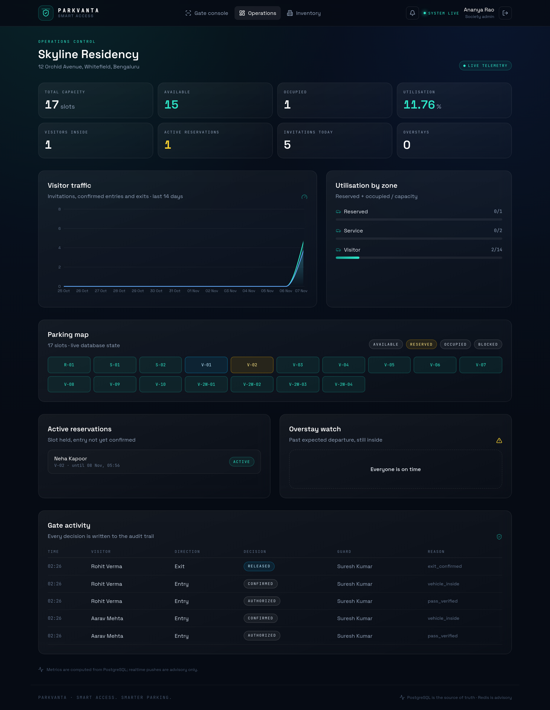

<p align="center"><em>Operations console — seeded Skyline Residency, 17 bays, one confirmed visitor, live telemetry.</em></p>

<table>
<tr>
<td width="50%">
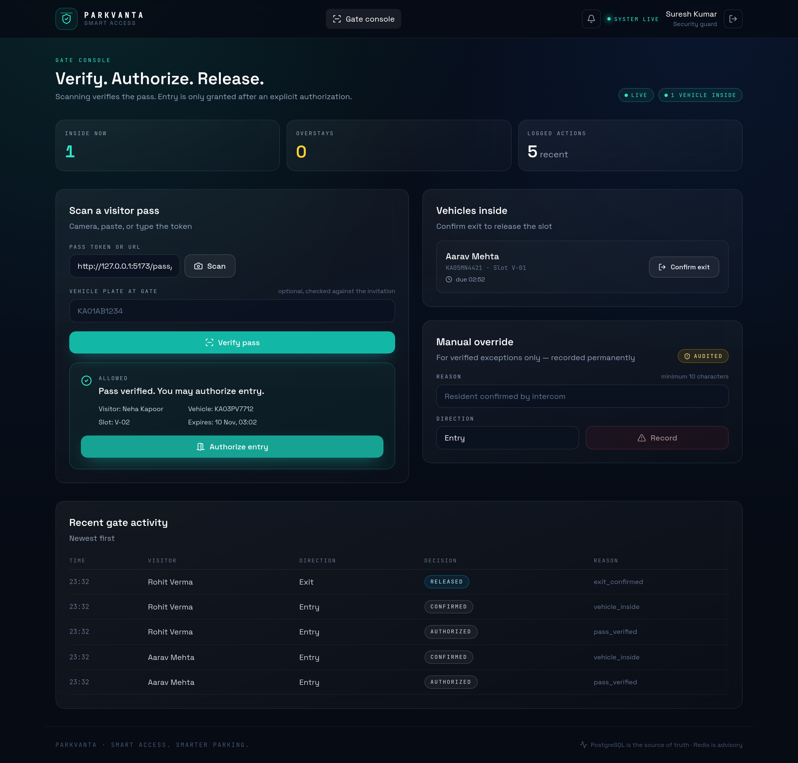
<p align="center"><em>Gate console — verified pass, explicit authorization, one vehicle inside.</em></p>
</td>
<td width="50%">
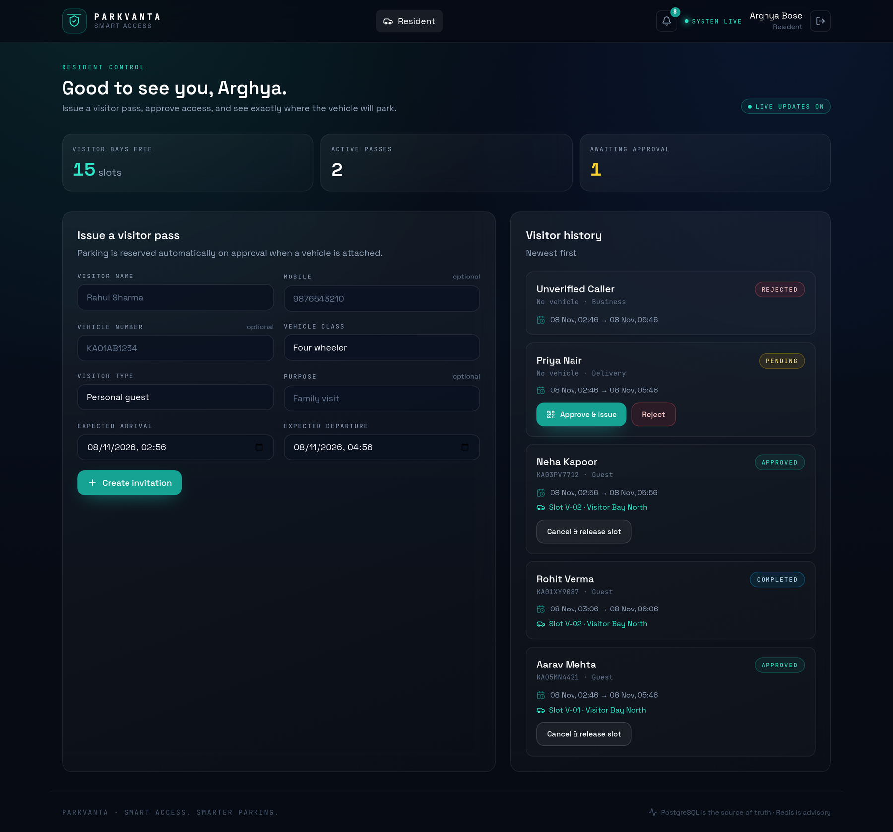
<p align="center"><em>Resident control — invitation states, assigned bay, active passes.</em></p>
</td>
</tr>
<tr>
<td width="50%">
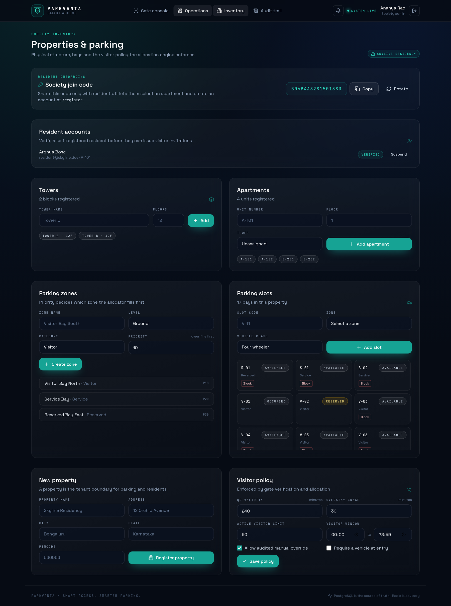
<p align="center"><em>Inventory — physical structure, bays and the policy the allocator enforces.</em></p>
</td>
<td width="50%">
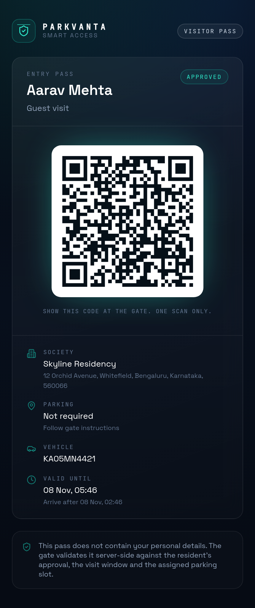
<p align="center"><em>Visitor pass — no account, no app, no PII inside the QR.</em></p>
</td>
</tr>
</table>

---

## Design theories

ParkVanta is opinionated. These are the six theories the implementation is built on, and the mechanism that makes
each one testable.

| # | Theory | Mechanism | Evidence |
| :-: | :--- | :--- | :--- |
| 1 | **Parking is a ledger, not a status field.** A bay has a lifecycle with legal transitions. | Reservation, occupancy and slot states are separate rows; every transition is one transaction. | Lifecycle test asserts `AVAILABLE → RESERVED → OCCUPIED → AVAILABLE`. |
| 2 | **A pass is a capability, not an identifier.** Possession authorizes one entry, once. | 256-bit CSPRNG token, SHA-256 hash at rest, conditional consumption `WHERE status='ACTIVE'`. | Two simultaneous authorizations → exactly one success, one `already_used`. |
| 3 | **Authorization is not actuation.** Opening a barrier, granting entry and recording occupancy are distinct events. | `verify → authorize → confirm entry`, each with its own audit row. | Gate test asserts separate `AUTHORIZED` and `CONFIRMED` events. |
| 4 | **Offline trust is asymmetric.** A disconnected gate may close a lifecycle, never open one. | Exits and audited overrides queue locally; entry confirmation requires a prior online authorization. | Offline reconcile rejects un-authorized entry with `authorization_required`. |
| 5 | **Realtime is a hint; PostgreSQL is truth.** A dropped event must never mean a dropped fact. | SSE carries ids and slot codes only; clients invalidate and refetch REST; bounded Stream replay. | SSE tests prove replay + publication; UI polls when disconnected. |
| 6 | **Concurrency safety belongs in the schema.** Application checks are advisory; constraints are final. | `FOR UPDATE … SKIP LOCKED`, partial unique indexes on active reservation/occupancy per slot. | Two threads, one free bay → exactly one reservation, one `no_slot_available`. |

If a theory cannot be expressed as a constraint, a test, or a measurable number, it stays out of the product.

---

## Architecture

A modular monolith with explicit domain boundaries — one deployable, one transaction stream, no premature
microservices.

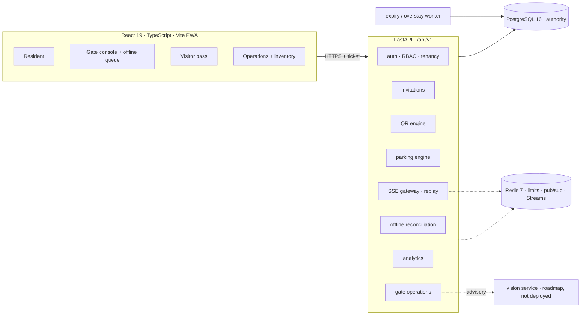

**Invariants live in the database**

- `FOR UPDATE OF parking_slots SKIP LOCKED` when claiming the next compatible bay.
- Partial unique indexes: one active reservation per slot, one active occupancy per slot.
- Conditional pass consumption: `UPDATE … SET status='CONSUMED' WHERE status='ACTIVE'`.
- Offline idempotency: unique `(property_id, client_event_id)` on the reconciliation ledger.
- Every multi-table transition is one transaction; a failed allocation rolls the approval back.

### Parking state machine

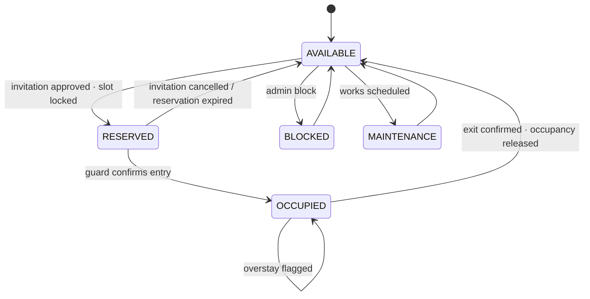

A reserved bay is **not** occupied. Only a guard-confirmed entry flips that state.

### Entry decision — evaluated server-side, in order

| # | Gate | Denial code |
| :-: | :--- | :--- |
| 1 | Token hashes to a known pass | `invalid_pass` |
| 2 | Pass belongs to the guard's society/property | `wrong_society` |
| 3 | Pass is not revoked | `revoked` |
| 4 | Pass has not been consumed | `already_used` |
| 5 | Inside its validity window and arrival grace | `expired` / `not_yet_valid` |
| 6 | Resident approval is present | `awaiting_approval` / `rejected` / `cancelled` |
| 7 | Plate at the gate matches the invited vehicle | `vehicle_mismatch` |
| 8 | A compatible slot is reserved | `no_slot_available` |
| 9 | Visitor window policy allows entry | `outside_visitor_window` |

A verified QR is not a granted entry. Authorization, physical gate opening and occupancy confirmation are three
separate events, all audited.

### Realtime with replay

`EventSource` cannot send an `Authorization` header, so a client exchanges its bearer token for a **2-minute,
property-scoped stream ticket**. Every event is archived first in PostgreSQL (`realtime_events`, 30-day
retention) and then published to a bounded Redis Stream for low-latency fan-out. Frame ids are archive
sequences, so a reconnect with `Last-Event-ID` (or `?last_event_id=`) replays the durable archive and then tails
Redis — no 500-frame loss window.

Events are advisory. Receipt triggers a REST refetch; if Redis or the stream is unavailable, polling still
converges on PostgreSQL. Event ids, types and slot codes are sent — never visitor PII.

### Offline trust boundary

The guard console caches active visitors and queues gate actions in **IndexedDB** when connectivity drops, with a
small localStorage fallback for browsers that block IndexedDB.

| Offline action | Behaviour | Server guarantee |
| :--- | :--- | :--- |
| Verify / authorize entry | **Blocked** until online | An offline device cannot authorize a pass |
| Confirm entry | Allowed only if authorized online earlier | Server re-checks the `AUTHORIZED` event |
| Confirm exit | Queued with timestamp + device id | Idempotent reconciliation releases once |
| Manual override | Queued with mandatory reason | Recorded as `MANUAL_OVERRIDE` in the audit trail |

Each queued action carries a client event id. Replaying the queue, a double click, or a network retry cannot apply
an action twice. Device timestamps more than 5 minutes ahead, or older than 7 days, are rejected.

---

## Measured, not marketed

Two real authenticated HTTP runs against the seeded API on a local Docker PostgreSQL 16 instance: a 20-client
read workload and a write workload built from full gate cycles plus contended bay approvals.

**Environment** — AMD Ryzen 7 8840HS · 16 threads · Linux x86_64 · Python 3.12.3 · PostgreSQL 16 (Docker) · Redis 7.
**Command** — `make load-test` → `docs/benchmarks/local-20c.json`. **Recorded** — 2026-11-08.

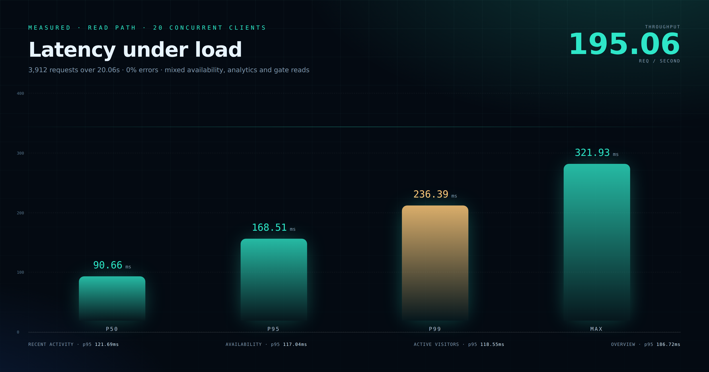

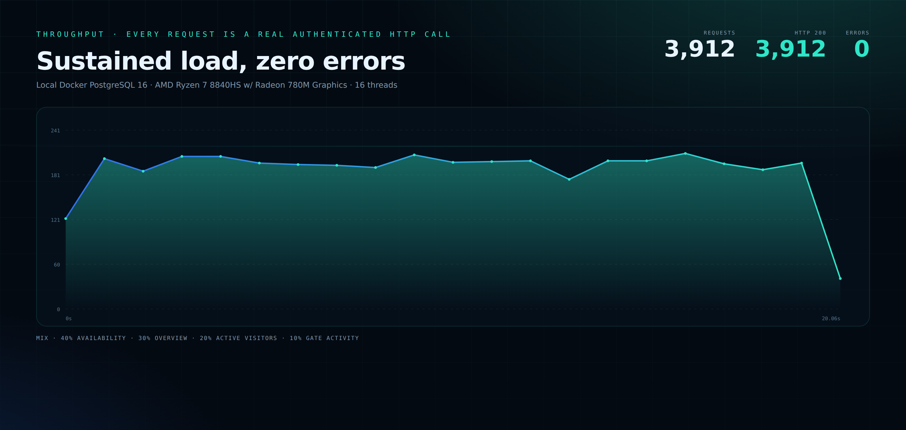

| Metric | Result |
| :--- | ---: |
| Concurrency / duration | 20 clients / 20.06 s |
| Requests / throughput | 3,912 / **195.06 req/s** |
| Errors | **0** (0.000%) |
| Mean latency | 102.18 ms |
| p50 / p95 / p99 | **90.66 / 168.51 / 236.39 ms** |
| Max observed | 321.93 ms |

| Endpoint (weight) | Requests | p50 | p95 | p99 |
| :--- | ---: | ---: | ---: | ---: |
| `/parking/availability` (40%) | 1,578 | 81.48 ms | 117.04 ms | 198.61 ms |
| `/analytics/overview` (30%) | 1,168 | 139.73 ms | 186.72 ms | 260.91 ms |
| `/gate/active-visitors` (20%) | 751 | 81.58 ms | 118.55 ms | 194.17 ms |
| `/gate/recent-activity` (10%) | 415 | 79.64 ms | 121.69 ms | 220.33 ms |

This measures the **read path** on one host. It is a regression baseline, not a capacity guarantee for a pilot with
different hardware, database size or write concurrency. The generator and raw JSON are in the repository so the
number can be reproduced — and challenged.

### Write path and allocation contention

`make load-test-write` builds a fresh database, creates **106 visitor bays**, blocks the 17 seed bays from the run,
and approves 106 visits. It then frees exactly **6 bays** and fires 30 approvals at a time for three rounds. Finally,
16 workers drive **100 complete gate cycles** — authorize, confirm entry, confirm exit — through authenticated HTTP.

Raw JSON: [`docs/benchmarks/write-local.json`](docs/benchmarks/write-local.json). **Recorded** — 2026-11-08.

| Write metric | Recorded |
| :--- | ---: |
| Gate cycles completed | **100 / 100** |
| Gate requests | **300** |
| Gate errors | **0** |
| Gate throughput | **28.09 cycles/s** |
| Cycle p50 / p95 / p99 | **544.88 / 729.20 / 745.45 ms** |
| Authorize p95 | **348.14 ms** |
| Confirm-entry p95 | **221.72 ms** |
| Confirm-exit p95 | **231.95 ms** |
| Contention attempts | **90** (3 × 30) |
| Allocations / expected | **18 / 18** |
| `no_slot_available` conflicts | **72** (expected) |
| Unexpected statuses | **0** |
| Duplicate active reservations | **0** |
| Duplicate active occupancies | **0** |
| Active reservations after run | **0** |
| Lifecycle events | **100 AUTHORIZED · 100 CONFIRMED · 100 RELEASED** |

Each gate cycle commits three times and emits events, so its latency is intentionally reported separately from the
read benchmark. The contention figure is the stronger proof: with six free bays, exactly six approvals may win —
and across 90 attempts, exactly 18 did, with no duplicate active row for any slot.

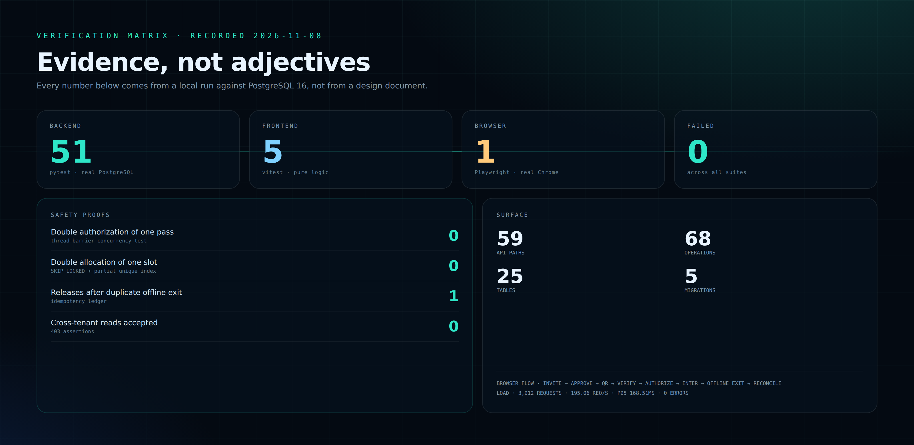

---

## How ParkVanta compares

Legend: **●** first-class and enforced · **◐** partial / manual · **○** absent.

| Dimension | Paper register | Generic visitor app | **ParkVanta** |
| :--- | :---: | :---: | :---: |
| Visitor authorization | ○ verbal | ● approval | **● single-use capability + resident approval** |
| Vehicle binding | ○ | ◐ optional note | **● plate normalized and matched at gate** |
| Parking allocation | ○ unmanaged | ◐ manual note | **● transactional bay reservation** |
| Double-allocation prevention | ○ | ◐ application check | **● row locks + partial unique indexes** |
| Entry vs occupancy | ○ conflated | ◐ one timestamp | **● authorized, confirmed and released are separate** |
| Exit releases the bay | ○ | ◐ sometimes | **● atomic occupancy + slot release** |
| Works during network loss | ● paper | ○ fails closed | **◐ exits/overrides queue; entry stays online-only** |
| Realtime updates | ○ | ◐ polling | **● SSE + bounded replay, REST authoritative** |
| Manual override traceability | ○ verbal | ◐ admin note | **● mandatory reason + audit event** |
| Tenant isolation | ● physical | ◐ varies | **● org/property scope + 403 regression tests** |
| AI dependency for entry | ○ | ○ | **● none; vision is roadmap-only, not deployed** |

The comparison is about enforced behaviour, not feature checklists. A tool can display a parking field without
guaranteeing that two vehicles cannot claim the same bay; ParkVanta treats that guarantee as the product.

---

## Quickstart

```bash
git clone https://github.com/officialarghya29/ParkVanta.git && cd ParkVanta
cp .env.example .env

docker compose up -d db redis     # PostgreSQL :55432 · Redis :56379
make install                      # Python 3.12 venv + pinned deps
make migrate                      # Alembic → 25 tables · 5 migrations
make seed                         # development demo society, 17 bays, accounts

make api                          # API      → http://localhost:8080  (docs: /docs)
make web-install && make web      # Frontend → http://localhost:5173
```

Health checks: `curl localhost:8080/health` · `curl localhost:8080/ready` · `curl localhost:8080/metrics`
(Prometheus; set `METRICS_TOKEN` to require a bearer token). `make worker-health` exits non-zero when the
email outbox or a worker heartbeat is stale.

### Demo accounts

Seeded by `make seed`; password **`ParkVanta@2026`** (override with `SEED_PASSWORD`).

| Email | Role | What to try |
| :--- | :--- | :--- |
| `resident@skyline.dev` | Resident | Create and approve an invitation, open the QR pass |
| `guard@skyline.dev` | Security guard | Verify, authorize, confirm entry, go offline, queue the exit |
| `admin@skyline.dev` | Society admin | Capacity, utilisation, overstays, gate trail, inventory |
| `manager@skyline.dev` | Property manager | Same operations scope |
| `superadmin@parkvanta.dev` | Platform owner | Organization-level access |

> Demo credentials exist only in the development seed. Production onboarding uses the command below; it creates
> no demo accounts.

### Production bootstrap

On an empty database, create the first real society and administrator:

```bash
export BOOTSTRAP_ORG_NAME="Skyline Communities"
export BOOTSTRAP_ORG_SLUG="skyline"
export BOOTSTRAP_PROPERTY_NAME="Skyline Residency"
export BOOTSTRAP_ADMIN_NAME="Ananya Rao"
export BOOTSTRAP_ADMIN_EMAIL="admin@example.com"
export BOOTSTRAP_ADMIN_PASSWORD="$(openssl rand -hex 16)"
make bootstrap
```

The command creates one organization, one property, its default policy and the first society admin. It prints the
property join code and refuses to overwrite an existing slug or email. Share the join code with residents; they
register at `/register`, select their apartment, and remain unverified until an admin verifies them in
**Inventory → Resident accounts**.

---

## Verification

```bash
make test                         # 51 backend tests on real PostgreSQL
cd apps/web && npm test           # 5 frontend unit tests
cd apps/web && npm run test:e2e   # 1 Playwright lifecycle scenario (fresh E2E DB)
cd apps/web && npm run build      # type-check + production bundle
make load-test                    # read-path benchmark
make load-test-write              # gate cycles + contended allocations
make lint && make audit           # Ruff, pip-audit and npm audit
```

| Suite | Command | Result |
| :--- | :--- | ---: |
| Backend | `pytest -q` | **51 passed** |
| Frontend unit | `npm test` | **5 passed** |
| Browser E2E | `npm run test:e2e` | **1 passed** |
| Production build | `npm run build` | **passed** |
| Read benchmark | `make load-test` | **3,912 requests · 0 errors** |
| Write benchmark | `make load-test-write` | **100 cycles · 18/18 allocations · 0 errors** |
| Dependency audits | `make audit` | **0 known advisories** |

What the backend suite proves:

- complete visitor lifecycle, duplicate scan rejection, plate mismatch, cancellation, no-slot approval;
- refresh-token rotation/replay revocation, suspended accounts, cross-tenant 403s;
- manual override reason enforcement and audit rows;
- two thread-barrier concurrency proofs: one authorization wins; one allocation wins;
- entry confirmation is rejected with `authorization_required` until an online authorization exists;
- SSE ticket scoping, `text/event-stream` framing, Redis Stream retention and replay from `last_event_id`;
- offline exit reconciliation, duplicate replay, online-only entry confirmation, clock-skew rejection, and
explicit property scoping for society-wide accounts.

The Playwright scenario drives real Chrome through resident creation and approval → visitor QR → guard verify,
authorize, confirm entry → **network loss** → queued exit → reconnect and reconciliation → admin overview.

Raw verification snapshot: [`docs/results/verification.json`](docs/results/verification.json).

---

## Stack

| Layer | Choice |
| :--- | :--- |
| Core API | Python 3.12 · FastAPI 0.162 · Pydantic 2.14 |
| Data | PostgreSQL 16 · SQLAlchemy 2.1 · Alembic |
| Realtime / limits | Redis 7 · Streams, pub/sub, rate limits (advisory) |
| Web | React 19 · TypeScript · Vite 6 · Tailwind CSS 4 |
| Client data | TanStack Query · React Hook Form · Zod · Recharts |
| Scanning | `html5-qrcode` camera + manual token fallback |
| QR rendering | `qrcode` (client-side, URL payload, no PII) |
| Infra | Docker · Compose · Nginx · GitHub Actions |
| Verification | Pytest · HTTPX · Vitest · Playwright · Ruff · pip-audit · Bandit · custom load generators |
| AI (roadmap, not deployed) | OpenCV · YOLO · OCR · PyTorch, isolated service |

## Repository layout

```text
parkvanta/
├── backend/
│   ├── app/
│   │   ├── api/v1/routers/      # public · auth · tenancy · invitations · qr · parking · gate · events · analytics
│   │   ├── core/                # settings · security · deps · errors · rate limit
│   │   ├── database/            # engine · sessions · declarative base
│   │   ├── models/              # 23-table domain model
│   │   ├── schemas/             # request/response contracts
│   │   ├── services/            # auth · mail · qr · parking · invitations · gate · offline · events
│   │   ├── workers/             # expiry / overstay sweep
│   │   ├── bootstrap.py         # single-use first society + administrator
│   │   ├── seed.py              # development-only demo data
│   │   └── main.py
│   ├── migrations/              # reviewed Alembic revisions
│   └── tests/
├── apps/web/                    # React PWA + Playwright suite
│   └── e2e/                     # visitor lifecycle incl. offline transition
├── docs/
│   ├── assets/                  # captured screenshots, hero, result charts
│   ├── benchmarks/              # raw load-test JSON
│   ├── results/                 # verification snapshot
│   └── ...                      # PRD · SRS · architecture · database · API · security · AI · testing · deployment
├── scripts/                     # E2E API bootstrap · benchmark · asset capture
├── infrastructure/nginx/        # reference reverse proxy
├── .github/workflows/ci.yml     # backend + frontend + Playwright E2E
├── docker-compose.yml
├── Makefile
├── LICENSE
└── .env.example
```

## API surface

REST under `/api/v1`, consistent error envelope, OpenAPI at `/docs` — **59 paths, 68 operations**.

| Group | Representative endpoints |
| :--- | :--- |
| Auth | `POST /auth/login` · `/auth/refresh` · `/auth/logout` · `/auth/forgot-password` · `/auth/reset-password` |
| Public onboarding | `GET /public/join/{code}` · resident self-registration with a society join code |
| Tenancy | `POST /properties` · `/properties/{id}/join-code` · `/properties/{id}/towers` · `/apartments` · `/properties/{id}/residents` |
| Visitors | `POST /invitations` · `/invitations/{id}/approve` · `/reject` · `/cancel` |
| QR | `POST /qr/verify` · `POST /qr/revoke` · `GET /qr/pass/{token}` (public) |
| Parking | `GET /parking/availability` · `POST /parking/allocate` · `/parking/occupancies/{id}/release` |
| Gate | `POST /gate/entry/authorize` · `/entry/confirm` · `/exit/confirm` · `/manual-override` |
| Offline | `POST /gate/offline/reconcile` — idempotent batch, per-action results |
| Realtime | `POST /events/ticket` · `GET /events/stream?ticket=&last_event_id=` |
| Analytics | `GET /analytics/overview` · `/parking-utilization` · `/visitor-trends` · `/overstays` |
| Notifications | `GET /notifications` · `/notifications/unread-count` · `POST /notifications/{id}/read` · `/read-all` |

## Security model

- Argon2id passwords; 15-minute access tokens; opaque refresh tokens hashed at rest and rotated on use;
  replay of a rotated token revokes the entire session family.
- QR tokens carry 256 bits of CSPRNG entropy; only their SHA-256 hash is stored; scanning consumes them atomically.
- Tenant isolation on every query, with regression tests for cross-organization access.
- Login and refresh rate limiting (Redis-backed, per-process fallback).
- Audit trail for approval, verification, entry, exit, overrides, slot and policy changes.
- Stream tickets are 2-minute, property-scoped JWTs; the access token never appears in a stream URL.
- Offline entry is denied without a prior online authorization; replay is blocked by a unique ledger key.
- Society join codes are 64-bit, admin-only to read/rotate, and expose only active property/apartment labels.
- Password reset uses a single-use hashed token and configured SMTP; production returns 503 if delivery is absent.
- Access tokens stay in JavaScript memory; the httpOnly refresh cookie restores the session after reload.
- Realtime frames are archived in PostgreSQL before fan-out, with configurable retention and sequence replay.
- Prometheus metrics expose outbox depth and worker freshness without visitor PII; scraping can require a bearer
  token, with ready-made alert rules and a Grafana dashboard in `infrastructure/monitoring/`.
- Visitor email uses a status-tracked outbox with bounded retries; no delivery is claimed before SMTP accepts it.
- No PII in QR payloads; visitor-safe pass projection; no facial recognition.
- The application refuses to boot in production with the default development JWT secret.
- CI blocks on Ruff, `pip-audit`, npm audits (production and dev), the frontend gzip budget and Docker image
  size budgets; Bandit high-severity findings are clean.

---

## Known limitations

| Limitation | Impact | Next step |
| :--- | :--- | :--- |
| Both benchmarks run on one host | Results are regression baselines, not capacity guarantees | Repeat on pilot hardware and managed PostgreSQL |
| Write benchmark uses a synthetic bay pool | It proves code paths, not a specific society's capacity | Replay against a copy of pilot inventory |
| Event archive retention is 30 days | Disconnects older than the retention window cannot replay | Tune `EVENT_RETENTION_DAYS` or export the archive |
| Offline queue is device-local (IndexedDB) | Clearing site data or losing the device drops unsynced exits | Service-worker background sync + server-side export/import |
| Visitor email needs the outbox worker | If the worker stops, email stays `PENDING`; in-app notes still arrive | Managed scheduler, alert on pending age, provider failover |
| SMS/WhatsApp outbound is not implemented | Visitor updates are in-app + email only | Provider adapters with consent and delivery receipts |
| Vision AI not deployed | No ANPR/occupancy inference | Score a candidate with the offline gate in `docs/VISION_EVALUATION.md`; deploy only after it passes |

## Engineering roadmap — complete

- [x] **0–14** Domain model, auth, RBAC, QR engine, parking engine, gate operations, realtime SSE with replay
- [x] **15** Controlled offline gate mode: queued exits/overrides, idempotent reconciliation, online-only entry
- [x] **16** Admin inventory, policy and property onboarding screens
- [x] **17a** Playwright E2E including a network-loss transition
- [x] **17b** Reproducible load harness with recorded results
- [x] **17c** Dependency CVE gate, lint gate and mixed write-path benchmark
- [x] **17d** Production bootstrap, join-code onboarding, resident verification, notification inbox and SMTP reset
- [x] **17e** Durable event archive, email outbox worker, in-memory tokens and IndexedDB gate queue
- [x] **17f** Durable worker heartbeats, Prometheus outbox metrics and a stale-queue health command
- [x] **18a** Vision evaluation protocol, manifest validator and offline release gate
- [x] **19a** Single-property pilot runbook with backup, restore and monitoring procedures
- [x] **19b** Production hardening: request correlation ids, Prometheus metrics, worker heartbeats, health checks
- [x] **19c** Pilot preflight that blocks demo data, development secrets, stale workers and a broken outbox

## Field milestones — external inputs required

These are not engineering phases and are not claimed as complete. They need assets that do not exist in this
repository:

| Milestone | Requires | State |
| :--- | :--- | :--- |
| ANPR/occupancy model deployment | A labelled pilot dataset and a model that passes `docs/VISION_EVALUATION.md` | Awaiting model + data |
| Live single-property pilot | A real property, guards and a signed runbook | Awaiting site |

## Documentation

| Document | Contents |
| :--- | :--- |
| [`docs/PRD.md`](docs/PRD.md) | Problem, personas, scope, acceptance criteria |
| [`docs/SRS.md`](docs/SRS.md) | Functional and non-functional requirements |
| [`docs/ARCHITECTURE.md`](docs/ARCHITECTURE.md) | Boundaries, flows, state machines, trade-offs |
| [`docs/DATABASE_DESIGN.md`](docs/DATABASE_DESIGN.md) | ER model, invariants, allocation query, retention |
| [`docs/API_SPECIFICATION.md`](docs/API_SPECIFICATION.md) | Endpoints, roles, errors, examples |
| [`docs/SECURITY.md`](docs/SECURITY.md) | Threat model, RBAC matrix, QR, offline and privacy controls |
| [`docs/AI_DESIGN.md`](docs/AI_DESIGN.md) | Vision pipeline, confidence policy, evaluation |
| [`docs/VISION_EVALUATION.md`](docs/VISION_EVALUATION.md) | Executable offline gate for ANPR and occupancy predictions |
| [`docs/TESTING.md`](docs/TESTING.md) | Test report, benchmark, manual acceptance script |
| [`docs/DEPLOYMENT.md`](docs/DEPLOYMENT.md) | Environments, release, backups, monitoring |
| [`docs/PILOT_RUNBOOK.md`](docs/PILOT_RUNBOOK.md) | Single-property pilot, backup/restore and incident runbook |
| [`docs/DECISIONS/`](docs/DECISIONS) | Architecture decision records |

---

## License & ownership

**ParkVanta is proprietary software.** All rights, title and interest belong exclusively to the **ParkVanta Team**.

No permission is granted to copy, modify, distribute, sublicense, host or create derivative works from this
software without prior written permission. Access to this repository does not transfer any right. See
[`LICENSE`](LICENSE) for the full terms.

<div align="center">

**PARKVANTA** · *Smart Access. Smarter Parking.*

© 2026 ParkVanta Team. All rights reserved.

Engineered by **Arghya Bose**

</div>
