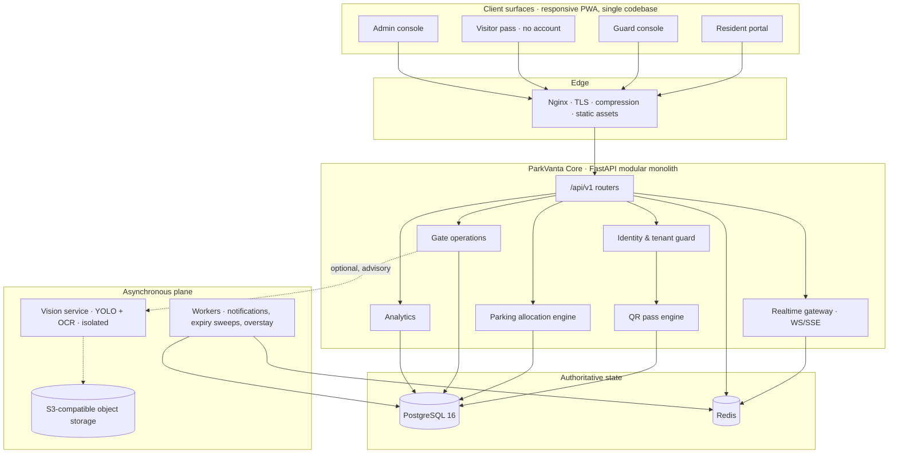
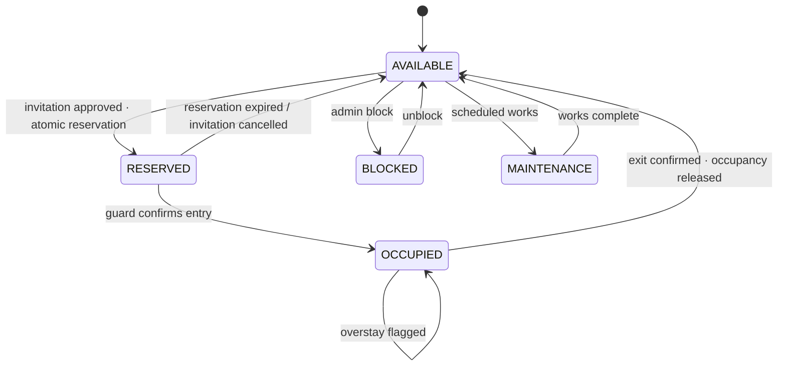

<div align="center">

# P A R K V A N T A

### Smart Access. Smarter Parking.

**An intelligent visitor verification, residential parking allocation and smart gate management platform.**

Built for gated communities where every visitor is verifiable, every approved vehicle has an authorized destination,
and every occupied parking slot has a traceable lifecycle.

<br />


</div>

---

> ### Project status — specification & architecture stage
>
> This repository holds the **product blueprint**: system architecture, domain model, API contract, security
> boundaries and the staged engineering roadmap. Runtime services, database migrations and interfaces are
> committed in the build order documented below — not in one uncontrolled code-generation pass.
>
> **Nothing in this README is claimed as shipped until its stage is checked off in the roadmap and verified by tests.**
> There are no screenshots because there is no UI yet, no badges for passing pipelines because the pipeline is not
> yet wired, and no seeded demo metrics pretending to be production data.

---

## The problem

A residential gate is a queue of unverifiable claims.

A guard writes a name into a register. A cab takes a slot reserved for guests. A delivery bike parks in a resident's
space for six hours. A visitor stays long after the resident's approval expired. Nobody knows how many visitor bays
were actually free at 7:40 pm, who authorized the white sedan inside bay V-14, or whether the vehicle that entered
is the vehicle that was invited.

Most visitor-management products stop at *approval*. ParkVanta treats **parking as the product**: allocation,
occupancy and release are first-class, concurrency-safe domain operations — not a text field in a spreadsheet.

## The ParkVanta thesis

| Layer | Question it answers | ParkVanta's answer |
| :--- | :--- | :--- |
| **Identity** | Who is this visitor? | Resident-issued invitation with an expiry window and a vehicle binding |
| **Access** | May this visitor enter *now*? | Server-validated, single-use, hashed QR pass — never a static apartment code |
| **Destination** | Where does the vehicle go? | Deterministic, transactional slot allocation against real slot state |
| **Lifecycle** | Is the slot still theirs? | Reservation → occupancy → release, with expiry, overstay and mismatch handling |
| **Evidence** | Who did what, when? | Append-only audit trail for every security-critical transition |

**Core promise:** an approved visit always resolves to exactly one authorized slot, and exactly one vehicle per slot —
enforced by the database, not by a UI check.

---

## Product surfaces

| Surface | User | What it does |
| :--- | :--- | :--- |
| **Resident portal** | Apartment owner / tenant | Invite visitors, bind vehicle numbers, approve entry, watch slot assignment and visit history |
| **Guard console** | Gate security | Scan, verify, authorize, confirm entry/exit — large touch targets, minimal typing, sub-minute flow |
| **Visitor pass** | The visitor (no account) | Openable web pass: visit details, live QR, assigned bay, directions, expiry |
| **Admin console** | Society / property admin | Properties, towers, apartments, residents, guards, zones, slots, live vehicles, reservations, reports, policy |
| **Vision service** | Optional AI layer | Number-plate recognition and occupancy inference; advisory only, never overrides a denial |

The visitor experience is deliberately account-free: a browser is enough. No app install, no PII inside the QR payload.

### Guard flow — the 60-second path

```text
SCAN QR → VERIFY PASS → CHECK APPROVAL → CHECK VEHICLE → CHECK PARKING
        → AUTHORIZE ENTRY → CONFIRM SLOT OCCUPANCY → EXIT → RELEASE SLOT
```

Every step returns an explicit, human-readable verdict — *valid pass*, *expired*, *already used*, *awaiting approval*,
*vehicle mismatch*, *no compatible slot*, *wrong society*, *denied* — because a guard at 11 pm should never have to
interpret an error code.

---

## System architecture

A modular monolith with an isolated inference service. One deployable core, clear domain boundaries, no premature
microservice sprawl.



**Design rules**

- PostgreSQL is the single source of truth. Redis caches, rate-limits and fans out events — it never decides availability.
- Real-time messages are notifications, not authority. A reconnecting client always re-reads state from the API.
- AI inference is optional and out-of-band. Vision downtime must never block a visitor or a gate.
- Every query is scoped by organization and property at the data-access layer, not in a controller `if`.

---

## The parking engine

The differentiator. Allocation is a transactional state machine, not a `SELECT` followed by hope.



**Slot categories:** visitor · resident · reserved · temporary · service · emergency · accessible.
**Vehicle compatibility:** slot category must admit the vehicle class (two-wheeler, four-wheeler, oversized, EV).

### Concurrency is the requirement

Two guards scanning at the same moment must not produce two authorizations or two allocations. The engine enforces
this in the database:

- `SELECT … FOR UPDATE SKIP LOCKED` when claiming the next eligible slot — no read-then-write races.
- Partial unique indexes for *one active occupancy per slot* and *one active reservation per slot*.
- `UNIQUE` on the QR token hash plus a conditional consume (`used_at IS NULL`) so a replay loses by constraint, not by timing.
- Explicit transaction boundaries around every multi-table transition; a failed step rolls back to a consistent state.
- Reservation TTL sweeps and overstay detection run as idempotent background jobs keyed by event id.

**Invariant:** a reserved slot is *not* occupied. Only a guard's confirmed entry flips that bit.

### Entry decision — evaluated server-side, in order

| # | Gate | Failure verdict |
| :-: | :--- | :--- |
| 1 | Pass token exists and hashes to a known pass | Invalid pass |
| 2 | Pass belongs to this society / property / gate | Wrong society |
| 3 | Pass is inside its validity window | Expired |
| 4 | Pass not revoked, not already consumed | Already used / revoked |
| 5 | Resident approval present | Awaiting approval |
| 6 | Vehicle at gate matches the invitation's plate | Vehicle mismatch |
| 7 | A compatible slot is reserved or reservable | No slot available |
| 8 | Visitor policy allows entry at this time | Denied by policy |

A verified QR is **not** a granted entry. Authorization and physical barrier opening are separate events, both audited.

---

## Data model

Twenty-four core entities spanning platform → society → property → tower → apartment → resident → visitor, and
property → zone → slot → reservation → occupancy.

```text
organizations → properties → towers → apartments → resident_profiles → users
properties → parking_zones → parking_slots → parking_reservations → parking_occupancies
invitations → qr_passes → entry_exit_events
audit_logs · notifications · approval_requests · vision_events · device_registrations · society_policies
```

Conventions: UUID primary keys · `organization_id` / `property_id` on every scoped table · UTC timestamps with
display-time conversion · foreign keys and unique constraints on every real-world invariant · Alembic migrations
only, never hand-edited production schemas · soft deletion only where retention or audit demands it.

---

## QR pass lifecycle

```text
invitation approved
   → 256-bit CSPRNG token generated
   → only SHA-256 hash persisted, token delivered once
   → visitor presents QR at gate
   → guard scans → backend validates all eight gates
   → pass consumed atomically on authorized entry
   → every scan attempt (valid, expired, replayed) written to the audit trail
```

No PII inside the QR. No static apartment code. No client-side trust. Revocation is instant and server-side.

---

## Technology stack

| Layer | Choice | Why |
| :--- | :--- | :--- |
| **Core API** | Python 3.12 · FastAPI · Pydantic v2 | Typed contracts, generated OpenAPI, async I/O |
| **Data** | PostgreSQL 16 · SQLAlchemy 2.x · Alembic | Transactional integrity, row-level locking, real migrations |
| **Cache / bus** | Redis | Rate limits, sessions, ephemeral state, fan-out |
| **Async work** | Celery-compatible worker layer | Expiry sweeps, notifications, retries with backoff |
| **Web** | React · TypeScript · Vite · Tailwind · shadcn/ui | One responsive codebase for resident, guard, visitor, admin |
| **Client data** | TanStack Query · React Hook Form · Zod · Recharts | Server-state discipline, validated forms, real charts |
| **Realtime** | WebSockets / SSE | Live slot and gate state, resumable from REST |
| **Mobile** | Installable PWA + camera QR scanning | Zero-install for visitors and guards; React Native only if truly justified |
| **Vision** | Python · OpenCV · YOLO · OCR engine · PyTorch | Isolated, versioned, confidence-scored inference |
| **Infra** | Docker · Docker Compose · Nginx · GitHub Actions · S3-compatible storage | Reproducible local parity and a real CI/CD path |
| **Quality** | Pytest · HTTPX · Vitest · Testing Library · Playwright · Bandit · dependency scanning | Tests prove behavior; scanners prove the surface |

Versions are pinned and verified together. Dependencies are never upgraded blindly.

---

## Repository layout

```text
parkvanta/
├── apps/
│   ├── web/                    # React + TypeScript PWA (resident · guard · visitor · admin)
│   └── vision/                 # Isolated inference service (detection · OCR · evaluation)
├── backend/
│   ├── app/
│   │   ├── api/v1/             # Versioned routers
│   │   ├── core/               # Config, security, logging, errors
│   │   ├── database/           # Sessions, base, migrations wiring
│   │   ├── models/             # SQLAlchemy domain models
│   │   ├── schemas/            # Pydantic contracts
│   │   ├── repositories/       # Tenant-scoped data access
│   │   ├── services/           # QR, allocation, gate, notifications, analytics
│   │   ├── security/           # Argon2id, JWT rotation, RBAC
│   │   ├── workers/            # Background jobs
│   │   └── main.py
│   ├── migrations/
│   └── tests/
├── infrastructure/             # Docker, Nginx, scripts, monitoring
├── docs/                       # PRD · SRS · architecture · DB · API · security · AI · testing · deployment
├── .github/workflows/          # Lint → typecheck → unit → integration → security → build → deploy
├── docker-compose.yml
├── .env.example
└── Makefile
```

---

## API surface

REST, versioned under `/api/v1`, consistent error envelope, pagination on every collection, idempotency keys on
retryable security operations.

| Group | Representative endpoints |
| :--- | :--- |
| **Auth** | `POST /auth/register` · `/auth/login` · `/auth/refresh` · `/auth/logout` · `GET /auth/me` |
| **Tenancy** | `POST /organizations` · `POST /properties` · `POST /properties/{id}/towers` · `POST /apartments` |
| **Residents** | `GET /residents` · `POST /residents` · `GET /residents/me` |
| **Visitors** | `POST /invitations` · `POST /invitations/{id}/approve` · `/reject` · `/cancel` |
| **QR** | `POST /qr/generate` · `/qr/verify` · `/qr/revoke` · `GET /qr/{id}/status` |
| **Parking** | `GET /parking/availability` · `POST /parking/allocate` · `GET/POST /parking/slots` · `POST /parking/occupancies/{id}/release` |
| **Gate** | `POST /gate/entry/authorize` · `/entry/confirm` · `/exit/confirm` · `/manual-override` · `GET /gate/active-visitors` |
| **Analytics** | `GET /analytics/overview` · `/parking-utilization` · `/visitor-trends` · `/overstays` |
| **Vision** | `POST /vision/detect-vehicle` · `/recognize-plate` · `/verify-vehicle` · `/parking-occupancy` |

Roles: `SUPER_ADMIN` · `SOCIETY_ADMIN` · `PROPERTY_MANAGER` · `SECURITY_GUARD` · `RESIDENT`.
Authorization is enforced in the backend on every request; hiding a button is not a permission model.

---

## Security model

- **Credentials:** Argon2id password hashing, short-lived JWT access tokens, rotating refresh tokens, HTTP-only
  secure cookies where the surface allows, login attempt monitoring and rate limits.
- **QR:** CSPRNG tokens, hash-only storage, single-use consumption, revocation, replay and duplicate-scan rejection.
- **Tenant isolation:** cross-society reads are a critical defect, tested explicitly, not assumed from query style.
- **Data exposure:** visitor contact details and plate records are restricted to authorized roles; analytics are
  aggregated so general reporting never leaks identities.
- **Audit:** approval, pass generation, verification, entry, exit, manual override, slot reassignment and permission
  changes all emit structured, traceable events.
- **Privacy:** minimum necessary collection, configurable retention, no facial recognition, camera images discarded
  unless a documented retention policy applies, designed against India's DPDP obligations.
- **Operations:** secrets in a manager, sanitized errors, restricted CORS, upload validation, dependency and static
  analysis in CI, documented backup and recovery.

---

## Engineering doctrine

1. Inspect before modifying. Never overwrite work whose purpose is not understood.
2. No placeholder logic, mock APIs or fake success responses on production paths.
3. Every critical operation: backend validation, error handling, transaction boundary, automated test.
4. Correctness, security and reliability outrank cleverness and scope.
5. Build incrementally; do not claim a stage complete until its tests pass.
6. Document every non-obvious architectural decision and its trade-off.
7. Keep AI and hardware optional. Keep the guard's job simpler, always.
8. Never expose secrets, passwords, QR tokens or visitor data.

---

## Build roadmap

Progress is gated on verified completion, not elapsed time. Each stage ships a working increment with tests.

- [x] **Stage 0** — Environment audit and baseline
- [x] **Stage 1a** — Product vision, architecture, domain model and API blueprint *(this document)*
- [ ] **Stage 1b** — Specification suite: PRD, SRS, database design, API spec, security, AI design, testing, deployment
- [ ] **Stage 2** — Monorepo scaffold, toolchain, pinned dependencies, local environment
- [ ] **Stage 3** — PostgreSQL schema, reviewed Alembic migrations, Docker Compose
- [ ] **Stage 4** — Backend foundation: config, sessions, error handling, logging, health/ready
- [ ] **Stage 5** — Authentication, RBAC and verified multi-tenant isolation
- [ ] **Stage 6** — Society, property, tower, apartment, resident and guard management
- [ ] **Stage 7** — Visitor invitations and resident approval workflow
- [ ] **Stage 8** — Cryptographic QR pass engine with concurrent-scan tests
- [ ] **Stage 9** — Concurrency-safe parking allocation engine
- [ ] **Stage 10** — Guard gate operations, manual override and controlled offline mode
- [ ] **Stage 11** — Resident, guard, visitor and admin interfaces wired to real APIs
- [ ] **Stage 12** — Realtime updates and multi-channel notifications
- [ ] **Stage 13** — ParkVanta Vision: ANPR, vehicle matching, occupancy inference
- [ ] **Stage 14** — Database-backed analytics and reporting
- [ ] **Stage 15** — End-to-end acceptance, security hardening, deployment and pilot readiness

### Definition of done for the pilot

Authentication, roles and tenant isolation work. Residents issue invitations. Visitors receive single-use passes.
Duplicate scans and concurrent allocations are provably rejected. Entry, exit and occupancy stay consistent.
Guards can run the gate without training. Admins manage properties. Notifications and audit logs are complete.
Analytics are database-backed. Mobile layouts work. Automated tests pass, critical security findings are closed,
and deployment is reproducible from documentation.

---

## Getting started

There is no runnable service in this repository yet — the foundation stage will add the toolchain, database and
Compose stack. Prerequisites for that stage:

| Requirement | Version |
| :--- | :--- |
| Python | 3.12+ |
| Node.js | 22+ |
| PostgreSQL | 16 |
| Redis | 7 |
| Docker + Compose | Latest stable |

Local setup, migration, seed and test commands will be documented here as each stage lands — and only after they
have been run against a clean environment.

---

## Documentation

| Document | Purpose | State |
| :--- | :--- | :--- |
| `docs/PRD.md` | Product requirements, personas, acceptance criteria | Planned |
| `docs/SRS.md` | Functional and non-functional requirements | Planned |
| `docs/ARCHITECTURE.md` | Component boundaries, data flow, decisions | Planned |
| `docs/DATABASE_DESIGN.md` | ER model, constraints, indexes, invariants | Planned |
| `docs/API_SPECIFICATION.md` | Request/response contracts, error envelope | Planned |
| `docs/SECURITY.md` | Threat model, RBAC matrix, QR and tenancy rules | Planned |
| `docs/AI_DESIGN.md` | Vision pipeline, thresholds, evaluation protocol | Planned |
| `docs/TESTING.md` | Test strategy, concurrency and security cases | Planned |
| `docs/DEPLOYMENT.md` | Environments, CI/CD, backup and rollback | Planned |
| `docs/DECISIONS/` | Architecture decision records | Planned |

---

## Non-goals for the MVP

- Facial recognition. Not now, not as a "convenience" feature.
- Payments and billing, until the subscription model is defined.
- Automatic barrier control before authorization semantics are proven.
- Native mobile apps before the PWA is validated at a real gate.
- Microservices, Kubernetes or anything that adds operational surface without a proven need.

---

<div align="center">

**PARKVANTA** · *Smart Access. Smarter Parking.*

Designed and engineered by **Arghya Bose**

</div>
