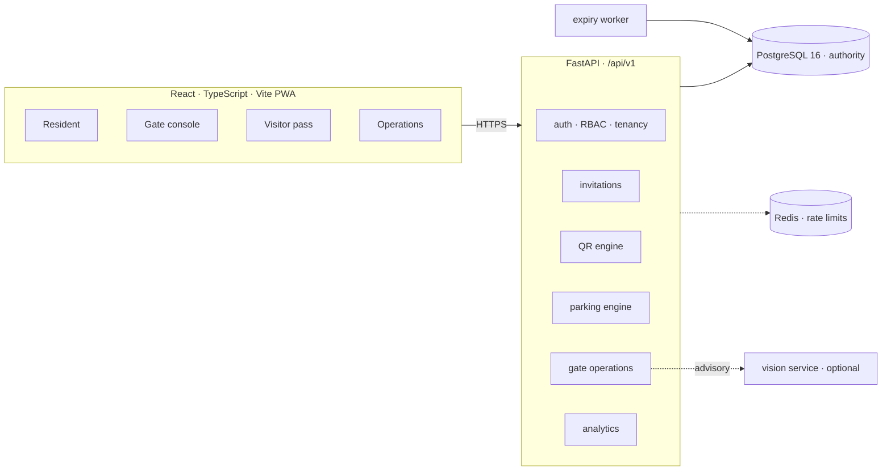
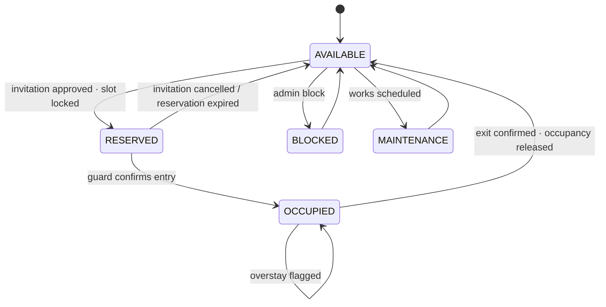

<div align="center">

# P A R K V A N T A

### Smart Access. Smarter Parking.

**Visitor verification, residential parking allocation and smart gate operations for gated communities.**

Every approved visit resolves to exactly one authorized parking slot, and every occupied slot has a
traceable lifecycle — enforced by PostgreSQL, not by a UI check.

<br />


</div>

---

> **Current state — verified.** The visitor → approval → QR → parking → entry → exit flow runs end to end against
> PostgreSQL, with concurrency tests proving that a single-use pass cannot authorize twice and two vehicles cannot
> claim one slot. Deferred work is listed explicitly in [Known limitations](#known-limitations) — nothing in this
> README is described as shipped until it is covered by a passing test or a running endpoint.

---

## The problem

A residential gate is a queue of unverifiable claims. A guard writes a name in a register. A cab takes a guest bay.
A delivery bike sits in a resident's space. Nobody knows how many visitor bays were free at 7:40 pm, who authorized
the white sedan inside V-14, or whether the vehicle that entered is the one that was invited.

Most visitor-management tools stop at *approval*. ParkVanta treats **parking as the product**: allocation,
occupancy and release are transactional domain operations.

## What ships today

| Capability | State | Evidence |
| :--- | :--- | :--- |
| Multi-tenant auth (Argon2id, JWT, rotating refresh, replay revocation) | Live | `tests/test_auth.py` |
| Roles: super admin, society admin, property manager, guard, resident | Live | Backend dependencies + service checks |
| Society → property → tower → apartment → resident hierarchy | Live | Models + migrations + admin APIs |
| Visitor invitations with vehicle binding and visit window | Live | End-to-end test |
| Single-use QR pass, hash-only storage, revocation, expiry | Live | Visa race test |
| Transactional parking allocation with `SKIP LOCKED` | Live | Concurrent allocation test |
| Slot lifecycle: available → reserved → occupied → available | Live | Lifecycle test |
| Gate console: verify, authorize, confirm entry/exit | Live | Lifecycle test |
| Manual override with mandatory reason + audit | Live | Test + audit assertion |
| Database-backed analytics and overstay detection | Live | `/analytics/*` endpoints |
| Expiry/overstay sweep worker | Live | `python -m app.workers.expiry` |
| Responsive PWA: resident, guard, visitor pass, admin | Live | Production build passing |
| Realtime WebSocket push | Not implemented | Clients poll every 15–20s |
| Email / SMS / WhatsApp delivery | Not configured | In-app notifications only |
| Number-plate AI, occupancy vision | Designed only | `docs/AI_DESIGN.md` |

## Product surfaces

| Surface | User | What it does |
| :--- | :--- | :--- |
| **Resident portal** | Apartment owner / tenant | Invite a visitor, bind a vehicle, approve, see the assigned bay, open/copy the QR pass |
| **Gate console** | Security guard | Camera or paste scan, explicit verdict, authorize, confirm entry, release on exit, audited override |
| **Visitor pass** | The visitor, no account | Opens from a link: live QR, slot, directions, validity window |
| **Operations console** | Society admin / manager | Capacity, utilisation, live owners, reservations, overstays, gate trail |
| **Vision service** | Optional AI layer | Designed for ANPR and occupancy inference; advisory only |

The visitor never installs an app. The guard never types more than a plate. The QR contains no personal data.

---

## Architecture

A modular monolith with explicit domain boundaries — one deployable, one transaction stream, no premature
microservices.



**Invariants live in the database**

- `FOR UPDATE OF parking_slots SKIP LOCKED` when claiming the next compatible slot.
- Partial unique indexes: one active reservation per slot, one active occupancy per slot.
- Conditional update for pass consumption: `WHERE status = 'ACTIVE'`.
- Every multi-table transition is a single transaction; a failed allocation rolls the approval back.

### Parking state machine



A reserved slot is **not** occupied. Only a guard-confirmed entry flips that state.

### Entry decision — evaluated server-side, in order

| # | Gate | Denial code |
| :-: | :--- | :--- |
| 1 | Token hashes to a known pass | `invalid_pass` |
| 2 | Pass belongs to the guard's society/property | `wrong_society` |
| 3 | Pass is not revoked | `revoked` |
| 4 | Pass has not been consumed | `already_used` |
| 5 | Inside its validity window and arrival grace | `expired` / `not_yet_valid` |
| 6 | Resident approval is present | `awaiting_approval` / `rejected` / `cancelled` |
| 7 | Plate at the gate matches the invited vehicle | `vehicle_mismatch` |
| 8 | A compatible slot is reserved | `no_slot_available` |
| 9 | Visitor window policy allows entry | `outside_visitor_window` |

A verified QR is not a granted entry. Authorization, physical gate opening and occupancy confirmation are three
separate events, all audited.

---

## Quickstart

```bash
git clone https://github.com/officialarghya29/ParkVanta.git && cd ParkVanta
cp .env.example .env

docker compose up -d db redis     # PostgreSQL :55432 · Redis :56379
make install                      # Python 3.12 venv + pinned deps
make migrate                      # Alembic → 22 tables
make seed                         # demo society, slots and accounts

make api                          # API      → http://localhost:8080  (docs: /docs)
make web-install && make web      # Frontend → http://localhost:5173
```

Health checks: `curl localhost:8080/health` · `curl localhost:8080/ready`.

### Demo accounts

Seeded by `make seed`; password **`ParkVanta@2026`** (override with `SEED_PASSWORD`).

| Email | Role | What to try |
| :--- | :--- | :--- |
| `resident@skyline.dev` | Resident | Create and approve an invitation, open the QR pass |
| `guard@skyline.dev` | Security guard | Scan/paste the pass, authorize, confirm entry, release on exit |
| `admin@skyline.dev` | Society admin | Capacity, utilisation, overstays, gate trail |
| `manager@skyline.dev` | Property manager | Same operations scope |
| `superadmin@parkvanta.dev` | Platform owner | Organization-level access |

> Demo credentials exist only in the development seed. Production onboarding creates real accounts through admin
> provisioning.

---

## Testing

```bash
make test                     # 17 backend tests on real PostgreSQL
cd apps/web && npm test       # 5 frontend unit tests
cd apps/web && npm run build  # type-check + production bundle
```

The backend suite runs against PostgreSQL (not SQLite) so locking and partial indexes behave exactly as in
production. It covers the full acceptance flow, tenant isolation, refresh-token replay, vehicle mismatch, slot
shortage, cancellation, manual override auditing — and two thread-barrier concurrency tests:

- two simultaneous authorizations of one pass → exactly one success, one `already_used`;
- two simultaneous allocations with one free slot → exactly one reservation, one `no_slot_available`.

See [`docs/TESTING.md`](docs/TESTING.md) for the full report and manual acceptance script.

---

## Stack

| Layer | Choice |
| :--- | :--- |
| Core API | Python 3.12 · FastAPI 0.162 · Pydantic 2.14 |
| Data | PostgreSQL 16 · SQLAlchemy 2.1 · Alembic |
| Cache / limits | Redis 7 (advisory only) |
| Web | React 19 · TypeScript · Vite 6 · Tailwind CSS 4 |
| Client data | TanStack Query · React Hook Form · Zod · Recharts |
| Scanning | `html5-qrcode` camera + manual token fallback |
| QR rendering | `qrcode` (client-side, URL payload, no PII) |
| Infra | Docker · Docker Compose · Nginx · GitHub Actions |
| Tests | Pytest · HTTPX · Vitest |
| AI (designed) | OpenCV · YOLO · OCR · PyTorch, isolated service |

## Repository layout

```text
parkvanta/
├── backend/
│   ├── app/
│   │   ├── api/v1/routers/      # auth · tenancy · invitations · qr · parking · gate · analytics
│   │   ├── core/                # settings · security · deps · errors · rate limit
│   │   ├── database/            # engine · sessions · declarative base
│   │   ├── models/              # 22-table domain model
│   │   ├── schemas/             # request/response contracts
│   │   ├── services/            # auth · qr · parking · invitations · gate · analytics
│   │   ├── workers/             # expiry / overstay sweep
│   │   ├── seed.py
│   │   └── main.py
│   ├── migrations/              # reviewed Alembic revisions
│   └── tests/
├── apps/web/                    # React PWA (resident · guard · visitor · admin)
├── docs/                        # PRD · SRS · architecture · database · API · security · AI · testing · deployment
├── infrastructure/nginx/        # reference reverse proxy
├── .github/workflows/ci.yml     # backend tests + frontend build
├── docker-compose.yml
├── Makefile
└── .env.example
```

## API surface

REST under `/api/v1`, consistent error envelope, OpenAPI at `/docs`.

| Group | Representative endpoints |
| :--- | :--- |
| Auth | `POST /auth/login` · `/auth/refresh` · `/auth/logout` · `GET /auth/me` |
| Tenancy | `POST /properties` · `/properties/{id}/towers` · `/apartments` · `/properties/{id}/residents` |
| Visitors | `POST /invitations` · `/invitations/{id}/approve` · `/reject` · `/cancel` |
| QR | `POST /qr/verify` · `POST /qr/revoke` · `GET /qr/pass/{token}` (public) |
| Parking | `GET /parking/availability` · `POST /parking/allocate` · `/parking/occupancies/{id}/release` |
| Gate | `POST /gate/entry/authorize` · `/entry/confirm` · `/exit/confirm` · `/manual-override` |
| Analytics | `GET /analytics/overview` · `/parking-utilization` · `/visitor-trends` · `/overstays` |

Full contracts: [`docs/API_SPECIFICATION.md`](docs/API_SPECIFICATION.md).

## Security model

- Argon2id passwords; 15-minute access tokens; opaque refresh tokens hashed at rest and rotated on use;
  replay of a rotated token revokes the entire session family.
- QR tokens carry 256 bits of CSPRNG entropy; only their SHA-256 hash is stored; scanning consumes them atomically.
- Tenant isolation on every query, with regression tests for cross-organization access.
- Login and refresh rate limiting (Redis-backed, per-process fallback).
- Audit trail for approval, verification, entry, exit, overrides, slot and policy changes.
- No PII in QR payloads; visitor-safe pass projection; no facial recognition.
- The application refuses to boot in production with the default development JWT secret.

---

## Known limitations

| Limitation | Impact | Next step |
| :--- | :--- | :--- |
| Polling instead of WebSockets/SSE | Dashboards refresh every 15–20s | Add SSE with Redis fan-out |
| No offline gate queue | Gate requires connectivity | Signed offline credentials + reconciliation |
| No email/SMS/WhatsApp provider | Pass links are copied/shared by the resident | Add a notification adapter with retry/status |
| Access token in `localStorage` | Larger XSS blast radius | In-memory token + strict CSP |
| Registration requires property/apartment IDs | No public onboarding wizard | Society invite codes + discovery endpoint |
| Admin UI is read-focused for inventory | Slot creation via API/seed | Inventory CRUD screens |
| No Playwright E2E or load tests | Browser regressions not gated | Add Playwright + k6 before pilot |
| Vision AI not deployed | No ANPR/occupancy inference | Stage 13 with measured accuracy |

## Roadmap

- [x] **0** Environment audit and baseline
- [x] **1** Specification suite (PRD, SRS, architecture, database, API, security, AI, testing, deployment)
- [x] **2** Monorepo scaffold, pinned toolchain
- [x] **3** PostgreSQL schema, reviewed migrations, Docker Compose
- [x] **4** Backend foundation: config, sessions, errors, logging, health
- [x] **5** Auth, RBAC and tenant isolation
- [x] **6** Society, property, resident and guard APIs
- [x] **7** Invitations and approval workflow
- [x] **8** Cryptographic QR engine with concurrent-scan test
- [x] **9** Concurrency-safe parking allocation engine
- [x] **10** Gate operations and audited manual override
- [x] **11** Resident, guard, visitor and admin interfaces
- [x] **12** In-app notifications and polling refresh
- [x] **13** Analytics, overstays and expiry worker
- [ ] **14** Realtime SSE/WebSocket gateway
- [ ] **15** Controlled offline gate mode
- [ ] **16** ParkVanta Vision (ANPR + occupancy) with evaluation protocol
- [ ] **17** Playwright E2E, load tests, dependency CVE gate
- [ ] **18** Pilot at one property and production hardening

## Documentation

| Document | Contents |
| :--- | :--- |
| [`docs/PRD.md`](docs/PRD.md) | Problem, personas, scope, acceptance criteria |
| [`docs/SRS.md`](docs/SRS.md) | Functional and non-functional requirements |
| [`docs/ARCHITECTURE.md`](docs/ARCHITECTURE.md) | Boundaries, flows, state machines, trade-offs |
| [`docs/DATABASE_DESIGN.md`](docs/DATABASE_DESIGN.md) | ER model, invariants, allocation query, retention |
| [`docs/API_SPECIFICATION.md`](docs/API_SPECIFICATION.md) | Endpoints, roles, errors, examples |
| [`docs/SECURITY.md`](docs/SECURITY.md) | Threat model, RBAC matrix, QR and privacy controls |
| [`docs/AI_DESIGN.md`](docs/AI_DESIGN.md) | Vision pipeline, confidence policy, evaluation |
| [`docs/TESTING.md`](docs/TESTING.md) | Test report and manual acceptance script |
| [`docs/DEPLOYMENT.md`](docs/DEPLOYMENT.md) | Environments, release, backups, monitoring |
| [`docs/DECISIONS/`](docs/DECISIONS) | Architecture decision records |

---

<div align="center">

**PARKVANTA** · *Smart Access. Smarter Parking.*

Designed and engineered by **Arghya Bose**

</div>
