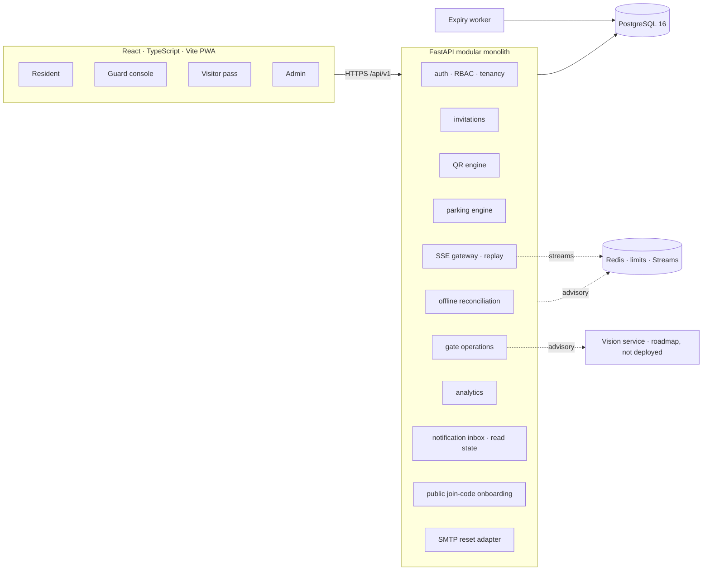

# ParkVanta — System Architecture

## 1. Shape

A **modular monolith** with an isolated inference service reserved for the roadmap. One deployable API, one
responsive web client, PostgreSQL as the authority, Redis for advisory state. No vision inference is deployed in
this release.



## 2. Layering

```text
routers (HTTP, roles, status codes)
  → services (business rules, transactions, audit)
    → repositories / SQLAlchemy Core & ORM queries
      → PostgreSQL
```

- Routers never compose multi-step transactions; services own commit boundaries.
- Tenant checks occur in the service layer through `assert_org_access` / `assert_property_access`.
- Audit rows are written inside the same transaction as the operation they describe.

## 3. Critical flows

### 3.1 Invitation approval with allocation

```text
BEGIN
  lock invitation row
  validate owner / state / policy
  SELECT slot … FOR UPDATE SKIP LOCKED   -- one compatible free slot
  UPDATE slot → RESERVED
  INSERT reservation (ACTIVE)            -- partial unique index backstop
  INSERT qr_pass (SHA-256 of 256-bit token)
  UPDATE invitation → APPROVED
  INSERT audit
COMMIT
```

If no slot is available the transaction rolls back and the invitation stays `PENDING`. Approval never creates a
false promise of parking.

### 3.2 Entry authorization

```text
verify pass (8 ordered gates, read-only)
  → if denied: write DENIED event + audit, return 403/409
  → if allowed:
      UPDATE qr_pass SET status = CONSUMED WHERE status = ACTIVE   -- atomic
      INSERT entry_exit_event (AUTHORIZED)
      INSERT audit
COMMIT
```

Entry confirmation is a separate step: it converts the reservation into an occupancy and flips the slot to
`OCCUPIED`. It requires an existing `AUTHORIZED` event, so a direct confirm call cannot bypass the pass.
Authorization is therefore never mistaken for physical presence.

### 3.3 Exit

```text
lock occupancy (ACTIVE)
  → occupancy RELEASED, slot AVAILABLE, reservation RELEASED, invitation COMPLETED
  → EXIT event + audit + resident notification
```

Repeated exits return `409 already_exited` rather than silently succeeding.

### 3.4 Realtime delivery

```text
client POST /events/ticket {property_id}
  → verify bearer + property access
  → signed JWT ticket (2 min, property-scoped)
client GET /events/stream?ticket=…[&last_event_id=…]
  → verify signature/scope
  → XREAD pv:stream:<property_id> from the last frame id
  → replay retained frames, then tail live frames
service commits transaction
  → publish_event(type, property_id, data)   -- never before commit
  → INSERT realtime_events (durable, 30-day retention, sequence id)
  → XADD stream (500-frame live window) + PUBLISH
  → SSE frame: id (archive sequence), type, occurred_at, data
client invalidates TanStack Query keys → refetch REST
```

Events are a latency optimisation, not state. Publishing happens after `db.commit()` in invitation, gate,
allocation, offline reconciliation and expiry paths. Every event is archived in PostgreSQL before Redis. A
reconnect passes `Last-Event-ID` (or `last_event_id`) to replay the durable sequence, then tails Redis. The
500-frame Redis window is only a live cache; the archive is the replay source and is purged by the expiry worker
after `EVENT_RETENTION_DAYS` (default 30). If Redis drops, polling still converges on PostgreSQL. Stream tickets
avoid putting the access token in a URL and expire after two minutes.

### 3.5 Email notification outbox

```text
transaction commits
  → notification_service: IN_APP row SENT + EMAIL row PENDING
worker every minute
  → claim PENDING rows (FOR UPDATE SKIP LOCKED)
  → SMTP accept → SENT + sent_at
  → SMTP unavailable → SKIPPED
  → SMTP failure → attempts += 1; retry with exponential backoff
  → 5 attempts exhausted → FAILED
```

The in-app note is authoritative and immediate. Email status never blocks a gate decision.

### 3.6 Onboarding and account recovery

```text
first deployment
  → python -m app.bootstrap
      → organization + property + policy + first society admin (single transaction)
      → refuses existing slug/email; prints the property join code
resident
  → GET /public/join/<code>       → property + apartment labels only
  → POST /auth/register           → user + resident profile, is_verified=false
admin
  → GET /properties/<id>/join-code (admin only), rotate to invalidate the old code
  → PATCH /residents/<id> {is_verified:true}
password reset
  → POST /auth/forgot-password    → hashed token, SMTP link if configured; generic response
  → POST /auth/reset-password     → consume token, revoke every refresh session
```

In-app notifications are stored per user with an explicit `read_at`, so the bell and the API share one source of
truth. Visitor SMS/email remains deliberately queued as roadmap work; the password-reset transport is a real
SMTP adapter, not a log-only stub.

### 3.7 Offline gate reconciliation

```text
client loses network
  → cache active visitors locally
  → block verify/authorize (entry cannot be authorized offline)
  → queue EXIT_CONFIRM / MANUAL_OVERRIDE with client_event_id, device_id, recorded_at
client reconnects
  → POST /gate/offline/reconcile (batch)
      → reject clock skew > 5 min or age > 7 days
      → reject ENTRY_CONFIRM without an online AUTHORIZED event
      → apply each action through the normal gate service
      → INSERT offline_gate_actions (unique property + client_event_id)
  → duplicate replay returns `duplicate` without a second transition
```

The ledger is the idempotency boundary; the gate tables remain the source of truth. Server time is
authoritative; the device timestamp is retained for audit and sanity checks only.

## 4. Data ownership and isolation

- Offline action ledgers are scoped by `property_id` and unique per client event id.
- Every scoped table carries `organization_id`; parking, invitations and events also carry `property_id`.
- Residents read only their own invitations.
- Guards read only their assigned property.
- Society admins read their organization; super admins may cross organizations deliberately.
- Analytics queries always require a resolved property.

## 5. State machines

**Slot:** `AVAILABLE → RESERVED → OCCUPIED → AVAILABLE`, with `BLOCKED` and `MAINTENANCE` as administrative
states. Reserved is never treated as occupied.

**Invitation:** `PENDING → APPROVED → COMPLETED`; terminal alternatives `REJECTED`, `CANCELLED`, `EXPIRED`.

**Pass:** `ACTIVE → CONSUMED | REVOKED | EXPIRED`.

## 6. Deployment topology

```text
Nginx / managed ingress (TLS)
   ├── static SPA (apps/web build)
   └── /api → uvicorn (FastAPI, N workers)
                 ├── PostgreSQL (managed, backups, PITR)
                 ├── Redis (rate limits, Streams replay, pub/sub)
                 ├── expiry worker (python -m app.workers.expiry)
                 ├── notification outbox worker (python -m app.workers.notifications)
                 └── worker health check (python -m app.workers.health)
```

Workers upsert a `worker_heartbeats` row after each successful run. `/metrics` exposes the email-outbox depth and
heartbeat age in Prometheus format; the health command exits non-zero when the queue or a heartbeat is stale.

## 7. Deliberate trade-offs

| Decision | Trade-off |
| :--- | :--- |
| Modular monolith | Simpler transactions and ops; no independent scaling per domain yet |
| Bearer access token in browser memory + httpOnly refresh cookie | Refresh is XSS-resistant; access token lifetime is 15 minutes |
| SSE + polling fallback instead of WebSockets | Simpler failure model, replay via Streams; database stays authoritative |
| Slot chosen at approval, not at arrival | Guarantees a destination; may hold a slot for a no-show until expiry |
| Pass issued at approval | Removes the "awaiting approval" scan state; the resident must approve before a pass exists |
| Visitor email uses a durable outbox; SMS/WhatsApp remain out of scope | Delivery status is explicit; in-app state never waits for email |
